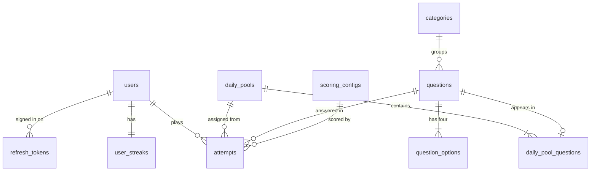
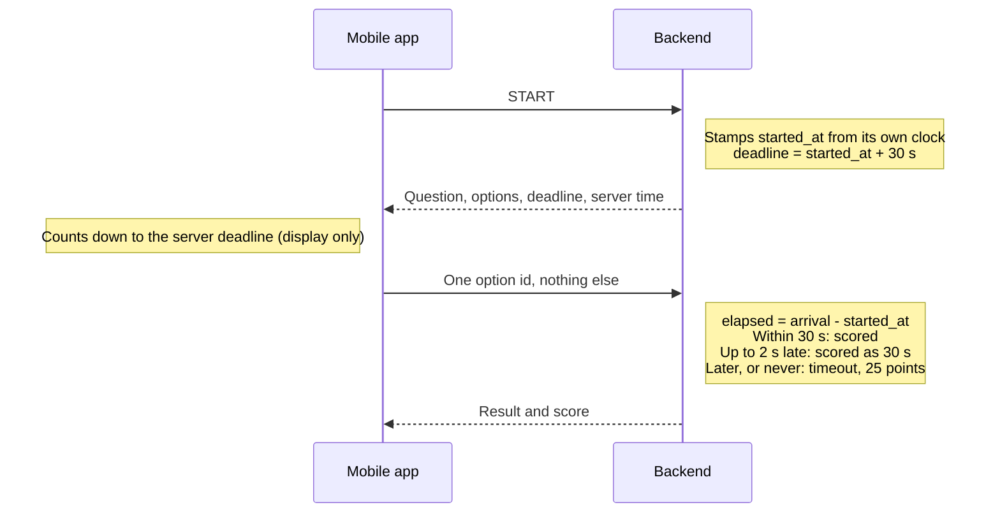
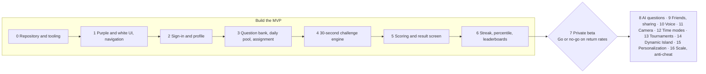

# 1% — Final Architecture

Agreed 6 October 2026. This file is the repository copy of the architecture document; update it in the same pull request as any change it describes.

## Summary and status

The architecture is final and follows your specification exactly. The repository is confirmed, with read and write access verified on 10 October 2026. Phase 0 started on 10 October 2026.

**Repository, verified on 6 October 2026**

| Item | Confirmed value |
| --- | --- |
| Repository | [subbu-palagiri9966/1-Percent](https://github.com/subbu-palagiri9966/1-Percent) |
| Remote URL | `https://github.com/subbu-palagiri9966/1-Percent` (fetch and push) |
| Visibility | Public: it can be read without credentials |
| Default and current branch | `main`, the only branch |
| History | One commit, `284ed69`, "Initial commit", by Subramanyam Palagiri |
| Contents | One file, `README.md`, containing only the heading "1-" |
| Working tree | Clean and level with `origin/main` |

The repository name is spelled `1-Percent`, with a capital P.

**GitHub access: read and write both work.**

| Check | Result |
| --- | --- |
| Read the remote and clone it | Succeeded |
| Attach the repository to this session with write access | Succeeded on 10 October, after the Claude GitHub App was installed |
| Push, as a dry run that sends nothing | Succeeded on 10 October; nothing was sent |
| GitHub API and command-line sign-in | Not enabled for this repository in this session |

The first checks on 6 October failed until the Claude GitHub App was given access to `1-Percent`. I will not report a push that did not happen.

Because the repository already has a commit and a README, Phase 0 will build on them and replace nothing without saying so.

**What changed from the earlier specification document**

- Backend is Java with Spring Boot, not Node.js.
- The server's own clock is the only source of elapsed time. The earlier idea of partly accepting the app's reported time is removed.
- Daily reminders and question reporting are out of the MVP, because your final list does not include them.
- Phases are renumbered 0 to 16, with the private beta as Phase 7.

**Three decisions still open.** Only the first blocks Phase 0. Details are in the last section.

| # | Decision | Blocks |
| --- | --- | --- |
| B1 | Write access to the 1-Percent repository | Phase 0 |
| B2 | Sign-in method. I recommend an emailed one-time code | Phase 2 |
| B3 | Minimum age for players | Phase 7 |

## 1. Product architecture

1% is one mobile app, one backend service and one database, built around a single record: the attempt. Each user gets one attempt per local calendar day.

Think of the attempt as a sealed exam script. The server hands out the paper, stamps the start time, collects the answer and marks it. The phone is only the desk the student sits at.

**The loop**

1. The user opens the app during their local day.
2. They press START. The server deals one question from today's pool and starts a 30-second clock.
3. They pick one of four options, or time runs out.
4. The server marks it and scores it from 0 to 1000.
5. The result shows percentile first, then global rank, then streak.
6. Tomorrow there is a new challenge.

**A user's day has exactly three states**

| State | Meaning | What Home shows |
| --- | --- | --- |
| Available | No attempt yet for today's date | The START button |
| In progress | Started, deadline not yet passed | The running question |
| Completed | Answered, wrong, or timed out | Today's score and the time until the next challenge |

**Rules the whole system enforces**

- One attempt per user per date. The database itself refuses a second one.
- The server decides the date, the question, the start, the deadline, correctness, score, rank and streak.
- The correct answer never reaches the phone before the attempt is finished.
- A scored attempt never changes afterwards.
- There is no feed and nothing to scroll after the result.

## 2. Mobile architecture

The app is a thin display layer in React Native, Expo and TypeScript. It holds no game rules: it asks the server what today's state is and draws it.

| Concern | Choice | Reason |
| --- | --- | --- |
| Language | TypeScript in strict mode | Catches mismatches with the API before the app runs |
| Navigation | Expo's file-based router | One file per screen; no hand-kept route table |
| Server data | A request-caching library | Uniform loading, error and retry behaviour on every screen |
| Local state | Component state only | The server holds all game state, so a global store would have nothing to keep |
| API types | Generated from the backend's OpenAPI description | App and server cannot drift apart silently across two languages |
| Token storage | The phone's secure storage | Session tokens must not sit in plain app storage |
| Design system | One theme file of colour, type and spacing tokens | Purple and white stay consistent; no screen invents its own colour |
| Tests | Jest with React Native Testing Library | Standard for Expo projects |

**Screens (10)**

| # | Screen | Purpose |
| --- | --- | --- |
| 1 | Splash | Check the session, then route |
| 2 | Onboarding | Explain the game in three cards |
| 3 | Sign in | Method per decision B2 |
| 4 | Profile setup | Username and country; timezone read from the device |
| 5 | Home | Today's state, streak, START |
| 6 | Daily challenge | Question, four options, countdown |
| 7 | Result | Correct or not, score breakdown, percentile, rank, streak, explanation |
| 8 | Leaderboard | Global and Country tabs, top 100, the user's own row pinned |
| 9 | Profile | Statistics |
| 10 | Settings | Country, sign out |

Home, Leaderboard and Profile are tabs. The tab bar is hidden during the challenge, and the challenge has no back button.

**Folder shape**

- `app/` holds the routes, one file per screen.
- `src/features/` holds one folder per area: auth, challenge, leaderboard, profile.
- `src/ui/` holds shared components: Button, Card, Timer, OptionButton, ScoreDisplay, RankDisplay, StreakDisplay, and Loading, Error and Empty states.
- `src/api/` holds the generated client. `src/theme/` holds the tokens.

**The countdown.** The start response carries the server's current time and the deadline. The app counts down the difference using the phone's monotonic timer, which ignores the wall clock. Changing the phone's clock therefore changes nothing, on screen or on the server.

**Accessibility.** Correct and incorrect always show an icon and a word as well as green or red. Text scales with the system font size. Touch targets are at least 44 points.

## 3. Spring Boot backend architecture

One Spring Boot service on Java, organised as a modular monolith with the eight modules you named. It is the only thing that talks to the database.

A modular monolith is one kitchen with separate stations. Each station has its own tools and passes plates through a hatch. Nobody reaches across into another station's fridge.

**Modules**

| Module | Owns | Exposes to other modules |
| --- | --- | --- |
| authentication | Sign-in, session tokens | The current user's id |
| users | Profile, country, timezone | User lookup; the user's local date |
| questions | Categories, questions, options, daily pools | A pool's questions; a question's correct option and difficulty |
| challenges | Attempts: assignment, start, answer, timeout | Completed-attempt events |
| scoring | The score formula and its versions | One pure function: inputs to score breakdown |
| leaderboards | Rank, percentile, day-close finalisation | Rank and percentile for an attempt |
| streaks | Streak state | Current and longest streak |
| statistics | Personal statistics | A user's statistics |

**Inside each module**

- `api`: REST controllers and request and response shapes.
- `application`: services that run one use case each, inside a transaction.
- `domain`: rules with no framework code. Scoring, streak and percentile maths live here.
- `persistence`: database entities and repositories, private to the module.

**Boundary rules**

- A module calls another only through its published service interface.
- No module reads another module's tables.
- An automated architecture test fails the build if either rule is broken.
- `challenges` announces "attempt completed" as an in-process event. `streaks` reacts in the same transaction, so the two cannot disagree.

**Technical choices**

| Concern | Choice | Reason |
| --- | --- | --- |
| Java version | Current long-term-support release | Stability; exact versions are confirmed when Phase 0 starts |
| Build | Maven with its wrapper | Simplest standard Spring setup; the wrapper pins the version for CI |
| Database access | Spring Data JPA; plain SQL for leaderboard queries | Ordinary records are simple; ranking queries need precise SQL |
| Schema changes | Flyway versioned migrations | Every schema change is a reviewed file in Git |
| Validation | Bean Validation on every request | Bad input is rejected before any logic runs |
| Security | Spring Security, stateless | No server sessions to store |
| Time | An injected `Clock` | Tests move time forward instead of waiting 30 seconds |
| Scheduled work | Spring's scheduler, idempotent jobs | Timeout sweep and day close need no extra infrastructure |
| API description | OpenAPI generated from the controllers | Feeds the mobile app's generated types |

**Scheduled jobs (2)**

- Timeout sweep, every minute: marks expired, unanswered attempts as timed out.
- Day close, hourly: finalises ranks for any date that has ended in every timezone.

**Repository layout**

- `backend/` the Spring Boot service.
- `mobile/` the Expo app.
- `docs/` this architecture and per-phase notes.
- `.github/workflows/` continuous integration.
- Root: `README`, `.gitignore`, `.env.example`, and a compose file that starts a local PostgreSQL.

## 4. PostgreSQL database design

The MVP needs 11 tables. Nine are certain; two (`login_codes`, `refresh_tokens`) depend on the sign-in method in decision B2.

| Table | Owned by | Why it exists |
| --- | --- | --- |
| `users` | users | One row per player: username, country, timezone, and the latest challenge date they have started |
| `login_codes` | authentication | Short-lived one-time sign-in codes, stored hashed. Needed only for emailed-code sign-in |
| `refresh_tokens` | authentication | Lets a phone stay signed in and lets one device be signed out. Stored hashed |
| `categories` | questions | The six launch categories as rows, so a seventh needs no schema change |
| `questions` | questions | Question text, type, category, explanation, difficulty values and approval status |
| `question_options` | questions | The four options, one marked correct. A separate table so options have ids the app can send back |
| `daily_pools` | questions | One row per date and mode: the difficulty band and a secret salt for assignment |
| `daily_pool_questions` | questions | Which questions are in which pool, with each question's difficulty frozen for that day |
| `attempts` | challenges | The single record of a user's day. Everything else is read from it or rebuilt from it |
| `user_streaks` | streaks | Current streak, longest streak, last completed date. A fast summary of attempts |
| `scoring_configs` | scoring | Each version of the scoring constants, so old scores stay explainable |

Statistics get no table. They are calculated from `attempts` on request, which is cheap at one row per user per day.

**Columns of `attempts`, the central table**

| Group | Columns |
| --- | --- |
| Identity | id, user, challenge date, mode |
| Assignment | pool, question, the shuffled option order |
| Timing | started at, deadline at, submitted at, elapsed milliseconds |
| Answer | selected option, status (in progress or completed), outcome (correct, wrong, timeout) |
| Score | difficulty used, correctness points, difficulty points, speed points, final score, scoring version |
| Ranking | country at the time, final global rank, final global percentile, final country rank |
| Integrity | timezone at start, flagged |

**Rules the database enforces itself**

| Rule | Mechanism | Why in the database |
| --- | --- | --- |
| One attempt per user, date and mode | Unique constraint | Two simultaneous requests cannot both succeed; application code alone cannot promise that |
| Score between 0 and 1000 | Check constraint | A bug cannot write an impossible score |
| Submitted at is not before started at | Check constraint | Guards the timing data |
| Exactly one correct option per question | Partial unique index | A question with two right answers cannot be stored |
| One pool per date and mode | Unique constraint | Assignment always has exactly one pool to draw from |
| Usernames unique regardless of letter case | Unique index on the lower-cased name | "Subbu" and "subbu" cannot both exist |
| Scoring versions are never edited | Insert-only by convention, plus a test | Historical scores must stay reproducible |

**Indexes for the leaderboard.** Two on `attempts`: one on date, mode, score, elapsed time and submission time; one with country added after mode. They make top-100 and rank lookups fast.

**Conventions**

- Timestamps are stored in UTC. The challenge date is a plain calendar date.
- Country is a two-letter ISO code. Timezone is an IANA name such as `Europe/Dublin`.
- Primary keys are UUIDs, so ids reveal nothing about user counts.
- `mode` is stored on pools and attempts from day one, with the single value `BLITZ`.

## 5. Entity relationships

`attempts` is the hub. Each attempt belongs to one user, one question, one daily pool and one scoring version.



`login_codes` is not drawn: it is matched to a user by email address, not by a database key, because a code can be requested before the user exists.

| Relationship | Cardinality |
| --- | --- |
| `users` to `attempts` | One user, many attempts; at most one per date and mode |
| `users` to `user_streaks` | One to one |
| `users` to `refresh_tokens` | One user, one token per signed-in device |
| `categories` to `questions` | One category, many questions |
| `questions` to `question_options` | One question, exactly four options |
| `daily_pools` to `daily_pool_questions` | One pool, about 8 entries |
| `questions` to `daily_pool_questions` | One question, at most one pool |
| `daily_pools` to `attempts` | One pool, many attempts |
| `questions` to `attempts` | One question, many attempts |
| `scoring_configs` to `attempts` | One version, many attempts |

Not drawn, to keep the picture readable: each attempt also records the option the user chose, which is empty on a timeout.

## 6. API endpoint plan

A REST API under `/v1` with 15 endpoints for the MVP. None are implemented yet. All except sign-in and health require a signed-in user.

| Module | Method and path | Purpose |
| --- | --- | --- |
| authentication | `POST /v1/auth/code/request` | Send a one-time code to an email address |
| authentication | `POST /v1/auth/code/verify` | Exchange the code for session tokens; creates the user on first sign-in |
| authentication | `POST /v1/auth/refresh` | Swap a refresh token for a new pair |
| authentication | `POST /v1/auth/logout` | Revoke this device's refresh token |
| users | `GET /v1/me` | Profile, including whether setup is complete |
| users | `PATCH /v1/me` | Set username, country, timezone |
| challenges | `GET /v1/challenges/today` | Today's state: available, in progress or completed, and when the next one opens. Never contains the question before START |
| challenges | `POST /v1/challenges/today/start` | Spend today's attempt. Returns question, shuffled options, server time, deadline |
| challenges | `POST /v1/challenges/today/answer` | Submit one option id. Returns the full result |
| challenges | `GET /v1/challenges/today/result` | Today's result again |
| challenges | `GET /v1/attempts` | Past attempts, newest first, paged by cursor |
| leaderboards | `GET /v1/leaderboards/daily` | Top 100 for a date; `scope` is `global` or `country` |
| leaderboards | `GET /v1/leaderboards/daily/me` | The user's rank, percentile and two neighbours each side |
| statistics | `GET /v1/me/stats` | Streaks and personal statistics |
| (platform) | `GET /health` | Liveness check for CI and hosting |

The four authentication paths assume emailed-code sign-in (B2). A different method changes those four rows and nothing else.

**Behaviour that matters more than the paths**

- **START is safe to repeat.** A second call returns the same question, the same option order and the original deadline. The clock never restarts.
- **ANSWER is safe to repeat.** A retry after a dropped connection returns the first result. A different option on retry is ignored.
- **A late answer is not an error.** It returns a normal result with the outcome "timeout".
- **The app never sends a date, a time or a score.** The answer request carries one option id and nothing else.
- **The start response omits which option is correct.** That appears only in the result.
- **Lists page by cursor**, so a board that changes while scrolling neither skips nor repeats rows.

## 7. Authentication architecture

I recommend passwordless sign-in by emailed one-time code, with sessions issued by the backend. Your specification requires registration and login but does not name a method, so this is decision B2.

**Why an emailed code.** It is the smallest design that is still safe: no passwords to store, leak or reset, and it works on iOS and Android without store-specific setup.

| Option | For | Against |
| --- | --- | --- |
| Emailed one-time code (recommended) | No password storage; one flow for sign-up and sign-in; proves the email is real | Needs an email-sending service before the beta |
| Email and password | Familiar | Needs password storage, a reset flow, and still an email service |
| Apple and Google sign-in only | One tap for the user | Needs developer accounts and native builds from day one; more setup before any screen works |
| Managed identity provider | Least code | An external dependency and possible cost at the centre of the app |

**How a session works**

1. The user enters an email. The server stores a hashed 6-digit code that expires in 10 minutes and allows 5 tries.
2. The user enters the code. The server issues two tokens.
3. The access token is a signed token valid for 15 minutes. Every request carries it, and the server verifies it without a database lookup.
4. The refresh token is a long random value valid for 30 days, stored hashed. It is swapped for a fresh pair when the access token expires.
5. Each refresh token works once. If a used one appears again, every session for that user is revoked, because it means a token was copied.

Think of the access token as a day pass and the refresh token as the membership card used to print a new day pass. A stolen day pass expires within minutes.

**Design points**

- The request-code endpoint always answers the same way, so it cannot be used to discover who has an account.
- Request-code and verify-code are rate limited per email and per network address.
- Sign-in sits behind one internal interface. Apple or Google sign-in can be added later as a second implementation without touching sessions.
- In local development the code is printed to the server log. No email service is needed until Phase 7.
- Until username and country are set, challenge endpoints refuse with a "profile incomplete" error, and the app routes to Profile setup.

## 8. Daily challenge assignment architecture

Each date has one pool of about 8 approved questions inside a 10-point difficulty band. At START, a keyed hash of the user's id picks one. The same user always gets the same question for that date.

It works like a cloakroom ticket. Your ticket number is fixed by who you are and which night it is. Asking again, from any device, returns the same coat.

**Step 1: which date**

- The server reads its own clock and the timezone stored on the user's account, and computes the user's local calendar date.
- The phone's clock is never consulted.
- A user's challenge date can only move forward. If a timezone change would put them back on a date they have already played or passed, there is no new challenge until their next date begins.
- The stored timezone can change at most once every 24 hours.

**Step 2: which pool**

The pool for that date and mode. A pool is valid only if:

- it holds at least 5 questions, with 8 as the target;
- every question is approved and has never been in an earlier pool;
- the gap between its easiest and hardest question is at most 10 difficulty points.

Each question's difficulty is copied into the pool and frozen for the day. Pools are scheduled ahead, and the health check warns when fewer than 7 future days are ready.

**Step 3: which question**

```latex
\text{position} = \mathrm{HMAC}(\text{pool salt},\ \text{user id}) \bmod N
```

N is the number of questions in the pool. The salt is a random secret created with the pool.

- **Deterministic:** the inputs never change, so refreshing or repeating the request cannot change the question.
- **Unpredictable:** without the salt, nobody can work out which question an account will get.
- **Even:** each of 8 questions goes to about one player in eight.
- **No repeats:** if the user has seen that question before, the server steps to the next position. This only matters once questions are reused.

The chosen question and a shuffled option order are saved on the attempt at START. From then on the saved row is the truth, not the formula.

**Why this is fair**

- All questions in a day sit within 10 difficulty points of each other.
- Scoring uses each question's own frozen difficulty. Within one pool that moves the score by at most 25 points, in favour of whoever drew the harder question.
- After each day closes, a check compares the average score on each question with the pool's average. A question more than 10% away was mis-rated and is flagged for review.

**Why this limits answer sharing.** A friend's answer helps only one time in eight, and the option order differs per attempt, so "it's B" is useless. It reduces sharing; it does not eliminate it.

**Learning real difficulty**

A new question's difficulty is an estimate. Real attempts replace it gradually:

```latex
d_{\text{calibrated}} = \frac{n \cdot d_{\text{observed}} + 50 \cdot d_{\text{estimate}}}{n + 50} \qquad d_{\text{observed}} = 100 \cdot \left(1 - \frac{\text{correct}}{n}\right)
```

The 50 acts as 50 imaginary attempts at the estimated difficulty. With 5 real attempts the estimate still rules; with 500 the evidence does. Calibration never changes a score already given. It improves future estimates and flags bad questions.

**Content needed.** 8 questions a day is 240 approved questions for a 30-day beta, about 40 per category. I can draft them, but a person must check every answer before approval.

## 9. Timing architecture

The server records the start, sets the deadline and measures elapsed time, all from its own clock. The app's countdown is a picture of that deadline and has no authority.



Read top to bottom. Every time value is created on the backend. The app sends no time at all.

**Recorded on every attempt:** started at, deadline at, submitted at, and elapsed milliseconds.

**Rules**

| Answer arrives | Outcome |
| --- | --- |
| Within 30 seconds of the start | Marked and scored on the real elapsed time |
| Up to 2 seconds after the deadline | Accepted and scored as exactly 30 seconds, so zero speed points |
| Later, or never | Timeout |

The 2-second grace exists only to absorb network delay near the deadline. It can never add speed points.

**Why manipulation fails**

| Attempt | Why it does nothing |
| --- | --- |
| Change the phone's clock | The server never reads it |
| Pause, background or kill the app | The server's clock keeps running |
| Modify the app to report a faster time | The answer request has no time field |
| Call START again for a fresh 30 seconds | START returns the original deadline |
| See the question, then start "properly" later | The question does not exist on the phone before START |

**One honest cost.** Network delay counts against the player, so a slow connection can cost a few speed points. The only way to remove that is to trust the app's own timing, which your specification rules out.

**Expired attempts.** A sweep runs every minute and marks unanswered attempts past their deadline as timeouts. The same check also runs whenever an attempt is read, so the app never sees a stale "in progress".

**Testability.** All server time comes from one injected clock. Tests move it forward by 31 seconds instead of waiting.

## 10. Scoring architecture

A correct answer scores 500 to 1000. A wrong answer scores 50 to 100. A timeout scores 25. Correctness therefore outweighs everything else by design, not by tuning.

**The model**

```latex
S_{\text{correct}} = 500 + \mathrm{round}\!\left(250 \cdot \frac{d}{100}\right) + \mathrm{round}\!\left(250 \cdot \frac{30 - \mathrm{clamp}(t,\,2,\,30)}{30 - 2}\right)
```

```latex
S_{\text{wrong}} = 50 + \mathrm{round}\!\left(50 \cdot \frac{d}{100}\right) \qquad\qquad S_{\text{timeout}} = 25
```

- d is the question's frozen difficulty, 0 to 100.
- t is the server-measured elapsed time in seconds.
- clamp keeps t between 2 and 30. Rounding is to the nearest whole number, halves up.

**Worked examples**

| Outcome | Difficulty | Time | Correctness | Difficulty pts | Speed pts | Score |
| --- | --- | --- | --- | --- | --- | --- |
| Correct, hard, instant | 90 | 2 s | 500 | 225 | 250 | 975 |
| Correct, medium, fast | 60 | 6 s | 500 | 150 | 214 | 864 |
| Correct, medium, slow | 60 | 25 s | 500 | 150 | 45 | 695 |
| Correct, easiest, last instant | 0 | 30 s | 500 | 0 | 0 | 500 |
| Wrong, hardest | 100 | any | 50 | 50 | 0 | 100 |
| Wrong, medium | 60 | any | 50 | 30 | 0 | 80 |
| Timeout | any | none | 25 | 0 | 0 | 25 |

**Why correctness always dominates**

- The lowest possible correct score is 500: difficulty 0, answered at 30 seconds.
- The highest possible wrong score is 100: difficulty 100.
- The gap is 400 points. The whole speed component is worth only 250, so no amount of speed can cross it.
- Speed appears only in the correct-answer formula. A wrong answer in half a second scores exactly the same as a wrong answer at 29 seconds.

The configuration loader also checks this guarantee. A scoring version is rejected at startup unless its maximum wrong score is below its minimum correct score, its timeout score is no higher than its minimum wrong score, and its maximum total is 1000.

**Other choices in the formula**

| Choice | Reason |
| --- | --- |
| Add components, do not multiply | Each line is explainable on the result screen, and one weak component cannot collapse the score |
| Full speed points at 2 seconds or less | Nobody reads a question and four options faster. It removes any reward for automated instant answers |
| Linear speed between 2 and 30 seconds | Simple to explain: each second costs about 9 points |
| Wrong answers earn slightly more on harder questions | Rewards attempting hard questions, as your specification allows |
| Timeout below any wrong answer | Answering always beats not answering |

**Service design**

- One scoring function in the `scoring` module. Inputs: outcome, elapsed time, difficulty, configuration. Output: the three components and the total.
- It is pure. It touches no database, clock or random number, so the same input always gives the same score.
- All eight constants (500, 250, 250, 50, 50, 25, the 2-second floor, the 30-second limit) live in one row of `scoring_configs`. None are written in application code.
- Each attempt stores the version it was scored with and its three components.
- A new version applies only to challenge dates after it is activated. Past attempts are never recalculated.

The numbers are your specification's 500, 250 and 250, plus my proposed 50, 50, 25 and 2 seconds for the parts you left open.

## 11. Leaderboard architecture

Every completed attempt joins the board for its challenge date. Global and country rankings are two views of that one board, and both are calculated in the database from `attempts`.

**Order.** Higher score first, then shorter elapsed time, then earlier submission. Because the last tie-breaker is exact, no two players share a rank.

**Global percentile**

```latex
\text{percentile} = \left\lfloor 100 \cdot \frac{\text{players on this date with a lower score}}{\text{all players on this date}} \right\rfloor
```

Example: 1,000 players, 870 scored lower, so the screen reads "You are better than 87% of players today." Players on the same score are not counted as beaten, so the claim is never overstated.

**Global rank.** One plus the number of attempts on that date that sort ahead of yours.

**Country rank.** The same calculation, limited to attempts carrying the same country code. The country is copied onto the attempt at START, so changing country later never rewrites an old board.

Flagged attempts are left out of every count.

**Provisional, then final**

With local calendar days, one date is open somewhere in the world for about 50 hours. The board is like a marathon with staggered start waves: positions keep shifting until the last wave is home.

- While a date is still open anywhere, percentile and rank are live and labelled "so far".
- With fewer than 20 finishers, the percentile is shown as provisional.
- Once the date has ended in the last timezone, the day-close job writes each attempt's final global rank, global percentile and country rank.
- Profile and history always show final values.

**Keeping "only rank 1 matters" out of the product**

- The result screen leads with the percentile sentence. Global rank sits beneath it, smaller.
- The leaderboard pins the user's own row with two neighbours above and below, so there is always a reachable next place.

**Performance**

- Two indexes on `attempts` serve the top 100 and rank counts directly.
- The top 100 for each board is cached in memory for 30 seconds.
- This is enough for tens of thousands of attempts a day. A faster design is Phase 16 work and needs no change to the tables.

**Ready for later boards.** A board is identified by date, mode and scope. Friends, city, category, tournament and time-mode boards are new scopes or modes on the same query. None are built now.

## 12. Streak architecture

A streak is the number of consecutive challenge dates on which the user completed an attempt. Correct, wrong and timed-out attempts all count.

It is a gym attendance card: stamped for turning up, not for lifting a personal best.

**Stored per user:** current streak, longest streak, last completed date.

**When an attempt for date D completes**

| Last completed date | Result |
| --- | --- |
| D minus 1 | Current streak increases by 1 |
| Earlier, or none | Current streak becomes 1 |
| D itself | Cannot happen: one attempt per date |

Longest streak rises whenever the current streak exceeds it.

**Design points**

- The update runs in the same database transaction that completes the attempt, so the two can never disagree.
- Timeouts complete through the sweep job, so an abandoned attempt still stamps the card.
- A missed day is detected when the streak is read: if the last completed date is older than yesterday, the streak shows as 0. No nightly job visits every user.
- The streak counts calendar dates, not 24-hour periods, so clock-change days need no special handling.
- `attempts` is the source of truth. The three stored values can be rebuilt from it at any time, and a test does exactly that.

## 13. Statistics architecture

All seven profile statistics are calculated from `attempts` and `user_streaks` when the profile is opened. Nothing is stored separately, so nothing can go stale.

| Statistic | Definition |
| --- | --- |
| Current streak | From `user_streaks`, shown as 0 if a day was missed |
| Longest streak | From `user_streaks` |
| Total challenges completed | Count of completed attempts |
| Best score | Highest final score |
| Average score | Mean final score over all completed attempts, including wrong answers and timeouts |
| Accuracy | Correct attempts divided by completed attempts, as a percentage |
| Percentile | The final global percentile of the most recent closed date |

A user has at most one attempt per day, so even after three years this reads about a thousand rows. A summary table is unnecessary until measurements say otherwise.

One definition to confirm: "percentile" on the profile could instead be the average across all days. I chose the most recent because it matches the daily habit.

## 14. Security architecture

The ranking is the product, so the first security goal is that nobody can earn a score they did not play for. The app is treated as untrusted in every design decision.

**Game integrity**

| Threat | Defence |
| --- | --- |
| Editing the score in the app | The app never sends a score; the server calculates it |
| Changing the phone's clock or pausing the timer | Only the server's clock is used |
| Answering after the deadline | Recorded as a timeout |
| Reading the answer from network traffic | The correct option is not sent until the attempt is complete |
| Peeking, then restarting | START spends the attempt; any later START returns the same running attempt |
| Refreshing for an easier question | Assignment is fixed per user and date |
| Submitting twice or from two devices | Unique constraint; the first answer wins |
| Replaying an earlier date by changing timezone | Challenge dates only move forward; timezone changes are limited to one per 24 hours |
| Automated instant answers | No extra reward below 2 seconds; repeated sub-2-second correct answers are flagged |
| A second account to preview the question | Helps one time in eight; sign-in is rate limited. Not fully preventable |
| Looking the answer up | Limited by 30 seconds and the speed score. Not fully preventable |

Two rows say "not fully preventable". That is deliberate honesty: a quiz on a phone cannot stop a determined person with a second device. The design makes cheating unrewarding and visible.

**Accounts and data**

- Every request is authenticated except sign-in and health.
- A user can read only their own profile, attempts and statistics. Leaderboards expose username, country and score, never email.
- Every request body is validated before any logic runs.
- Database access uses parameterised queries and a database account with only the rights it needs.
- All traffic is encrypted in transit outside local development.
- Codes and refresh tokens are stored only as hashes.

**Rate limiting and abuse**

- Limits per user and per network address, tightest on sign-in and START.
- In-memory limiting is enough for one backend instance and needs no extra infrastructure.
- The `flagged` column on attempts exists from day one, so later anti-cheat can exclude attempts without a schema change.

**Secrets**

- Secrets live in environment variables. None are in the repository, and none are in the mobile app.
- `.env.example` lists every variable with placeholder values.
- CI scans every push for accidentally committed secrets.
- Logs carry request ids and outcomes, never tokens, codes or email addresses.

## 15. Testing architecture

Testing effort follows risk. The heaviest testing goes on scoring, timing and the one-attempt rule, because a bug there corrupts the board for everyone.

| Layer | Covers | Tooling |
| --- | --- | --- |
| Scoring unit tests | Every row of the worked-examples table; boundaries at 0, 2 and 30 seconds; rounding | JUnit, table-driven |
| Scoring guarantees | Any correct beats any wrong. Faster never scores lower. Harder never scores lower. Always 0 to 1000. Same input, same output | Property-based tests over thousands of generated inputs |
| Configuration tests | An unsafe scoring version is rejected at startup | JUnit |
| Assignment tests | Same user and date gives the same question; spread across the pool is even; a seen question is skipped | JUnit |
| Date tests | Local date per timezone; dates never go backwards; clock-change days | JUnit with a fixed clock |
| Streak and percentile tests | Consecutive days, a gap, the first attempt, ties, one player, fewer than 20 players | JUnit |
| API tests | Start then answer; answer without start; repeated start keeps the deadline; duplicate answer; late answer; two simultaneous answers; another user's data refused | Spring's test client against a real PostgreSQL in a container |
| Database rule tests | A second attempt for the same user and date fails; two correct options fail | Direct inserts that must be refused |
| Architecture test | No module reaches into another's internals | Module-boundary verification |
| Mobile component tests | Each component in its loading, loaded, empty and error states; timer display; option selection | Jest and React Native Testing Library |
| Accessibility checks | Contrast, screen-reader labels, large text, correctness never by colour alone | Manual checklist per screen |

**Principles**

- Time is injected. No test waits 30 real seconds.
- Tests run against real PostgreSQL, because the most important rules are database constraints.
- No fake implementations to make a test pass. A test that cannot pass honestly is reported.
- Lint, type checks, tests and builds run in CI on every push.
- Every bug found by a user becomes a test before it is fixed.

## 16. Error handling architecture

Every error leaves the backend in one shape: the standard HTTP "problem details" format, plus a stable code and a request id. The app decides what to show from the code, never from the message text.

| Code | HTTP status | When | What the app does |
| --- | --- | --- | --- |
| `VALIDATION_FAILED` | 400 | A field is missing or malformed | Shows the message beside the field |
| `UNAUTHENTICATED` | 401 | Token missing or expired | Refreshes once, then returns to Sign in |
| `FORBIDDEN` | 403 | Asking for another user's data | Generic error screen |
| `NOT_FOUND` | 404 | Unknown resource | Generic error screen |
| `PROFILE_INCOMPLETE` | 409 | Username or country not set | Routes to Profile setup |
| `CHALLENGE_NOT_STARTED` | 409 | An answer arrives with no running attempt | Returns to Home and reloads today's state |
| `CHALLENGE_NOT_AVAILABLE` | 409 | No new challenge yet for this user | Shows when the next one opens |
| `USERNAME_TAKEN` | 409 | Username already in use | Asks for another |
| `RATE_LIMITED` | 429 | Too many requests | Waits, then retries |
| `POOL_UNAVAILABLE` | 503 | No valid pool for the date | "Today's challenge is on its way"; raises an alert |
| `INTERNAL_ERROR` | 500 | Anything unexpected | Generic error with the request id |

**Backend rules**

- One central handler converts every exception into this shape. Controllers contain no error-formatting code.
- Unexpected errors are logged with the request id and a stack trace. The response never includes internal details.
- Two situations are deliberately not errors: a repeated START and a late or repeated answer. Both return normal results.

**Mobile rules**

- Network failures retry automatically with increasing delays. This is safe because START and ANSWER can be repeated.
- If ANSWER cannot reach the server, the app keeps retrying and then loads the result. The server has already fixed the outcome by its own clock.
- Every data screen has a designed error state with a retry button. A top-level error boundary catches anything else.

## 17. Configuration and environment strategy

Configuration is split by who may see it: secrets come from environment variables, game rules live in the database or checked-in settings, and nothing secret ever enters the mobile app.

**Environments**

| Environment | Database | Created in |
| --- | --- | --- |
| Local | PostgreSQL in a container, seeded with labelled test data | Phase 0 |
| Test | A throwaway PostgreSQL per test run | Phase 0 |
| Beta | One small hosted backend and one hosted PostgreSQL | Phase 7 |
| Production | Hardened, backed up, monitored | Phase 16 |

Each has its own Spring profile. No staging environment is created before it is needed.

**Where each kind of setting lives**

| Setting | Lives in | Example |
| --- | --- | --- |
| Secrets | Environment variables | Database password, token signing key, email-service key |
| Per-environment values | Environment variables | Database address, allowed app origins |
| Scoring constants | `scoring_configs` table, seeded by a migration | 500, 250, 250, 50, 50, 25 |
| Timing and pool rules | Checked-in application settings | 30-second limit, 2-second grace, pool size, band width |
| Mobile settings | Public build-time variables | The API address only |

**`.env.example` will list**

- Database address, username and password.
- Token signing key.
- Email-service settings, if emailed-code sign-in is confirmed.
- The API address for the mobile app.

Every value in it is a placeholder. The real `.env` is in `.gitignore` from the first commit.

**Safeguards**

- The backend refuses to start outside local development if a required secret is missing or still a placeholder.
- Database schema changes run only through migrations, never by hand.
- Seed data is loaded only by the local profile, so test questions cannot reach a real board.

## 18. Git and GitHub development workflow

Each phase is built on its own branch, checked, committed in small conventional commits, pushed, and then stops for your instruction. Nothing here has run yet, because no repository is connected.

**Per phase**

1. Inspect the repository first. Existing work is used, never overwritten.
2. Create a branch named for the phase, for example `phase-1-ui-navigation`.
3. Build only that phase's scope.
4. Before every commit, run lint, type checks, tests and builds for the mobile app and the backend.
5. Commit only when all of them pass.
6. Push the branch and open a pull request into `main`.
7. Report, then stop. Your merge of the pull request is your approval of the phase.

The repository holds a single commit on `main`, so Phase 0 can start on its own branch like every other phase. If you prefer every phase pushed straight to `main`, say so and I will do that instead.

**Commit messages** follow the conventional format: a type, an optional scope, a short summary. Examples: `chore(repo): add tooling and CI`, `feat(scoring): add versioned scoring service`, `test(streaks): cover missed-day reset`. Commits made by me carry a co-author line saying so.

**Never**

- Force push, or rewrite existing history.
- Commit a secret, a key, a password, a token or a `.env` file.
- Commit failing or fake-passing code.
- Delete existing work without explaining why first.
- Start the next phase without your instruction.

**Continuous integration** runs on every push: backend build and tests, mobile lint, type check and tests, and a secret scan.

**Report after every commit and phase**

- Commit message, commit hash and branch.
- Files changed and features implemented.
- Results of tests, type check, lint and build.
- Push status and the repository's state on GitHub.
- Manual steps you need to perform.
- Known limitations.

If a push fails or access is missing, the report says exactly that and work stops.

## 19. Phase-by-phase implementation plan

Seventeen phases in your order, 0 to 16. Phases 0 to 6 build the MVP, Phase 7 tests it with real people, and Phases 8 to 16 wait on that result.



The Phase 7 decision is the only gate that can stop the roadmap. If users do not return, the next phase is improving the core loop, not Phase 8.

| Phase | Objective | Delivers | Done when |
| --- | --- | --- | --- |
| 0 | Architecture, repository, tooling | Repository layout, an empty Spring Boot service with a health check, an empty Expo app, local PostgreSQL, lint, type and test tooling, CI, README, `.env.example`, this document in `docs/` | A fresh clone builds, lints, tests and runs using only the documented commands, and CI is green |
| 1 | Purple and white UI, navigation | Theme tokens, shared components, all 10 screens on clearly labelled mock data | Every screen is reachable, each data screen has loading, loaded, empty and error states, and the accessibility checklist passes |
| 2 | Authentication and profile | Sign-in, sessions, profile setup with country and timezone | A user can sign up, sign out and sign in on a real phone; another user's data is refused |
| 3 | Question bank, daily pool, assignment | Question tables, a seeded and human-checked bank, pool validation, deterministic assignment | The same user and date always yield the same question; an invalid pool is refused |
| 4 | 30-second challenge engine | START, ANSWER, timeout sweep, server timing, the live challenge screen | One attempt per day holds under simultaneous requests; late answers become timeouts |
| 5 | Scoring and result screen | The scoring service, versioned configuration, the result screen | Every worked example reproduces exactly and the scoring guarantees pass |
| 6 | Streak, percentile, leaderboards | Streaks, statistics, global and country boards, the day-close job | All 19 MVP capabilities work end to end on a real phone |
| 7 | Private beta | Hosted backend, test builds, privacy policy, account deletion, about 240 approved questions, queries for your seven beta metrics | You review completion, Day-1 and Day-7 return, and decide go or no-go |
| 8 | AI question generation | A drafting pipeline with validation and a human approval queue | No generated question can go live unapproved |
| 9 | Friends and sharing | Friend requests, a friends board, a share card, privacy controls | Private data is never exposed; no feed exists |
| 10 | Voice | Voice as a new question type | The server decides correctness; audio is not kept |
| 11 | Camera and AI vision | Visual challenges as a new question type | The server validates completion; images are not kept |
| 12 | 30, 60 and 120-second modes | Two new modes with their own boards | An attempt never appears on another mode's board |
| 13 | Tournaments | Events with their own boards | Event boards are server-authoritative |
| 14 | Dynamic Island and Live Activities | A quick-entry layer on iOS | The app works fully without it; Android is unaffected |
| 15 | AI personalization | Skill profiles and explainable question selection | Personalization cannot alter competitive scores |
| 16 | Analytics, anti-cheat hardening, production scaling | Event tracking, anomaly detection, load testing, backups | Suspicious attempts are excluded automatically; recovery from backup is rehearsed |

In Phase 4 an attempt records its outcome and elapsed time. Its score is added in Phase 5, as your phase order requires.

**Definition of done, every phase**

1. One stated objective, and only that phase's scope is built.
2. Existing architecture is reused. Any rewrite is explained before it happens.
3. Tests and documentation are included.
4. Lint, type checks, tests and builds pass.
5. Clean conventional commits are pushed to GitHub.
6. A completion report is delivered.
7. Work stops until you give the instruction for the next phase.

## 20. MVP boundary

The MVP is everything through Phase 6: the 19 capabilities in your specification and nothing else.

**Inside**

| Area | Capabilities |
| --- | --- |
| Account | Registration and login, user profile, country |
| Challenge | Daily challenge, 30-second timer, answer submission, server-side timing |
| Score | Correctness, speed, difficulty, final score, result screen |
| Habit | Current streak, longest streak |
| Statistics | Personal best, average score |
| Ranking | Global percentile, global leaderboard, country leaderboard |

**Supporting pieces the capabilities require**

- A seeded, human-checked question bank and scheduled daily pools.
- Onboarding cards and a Settings screen with sign out.
- The timeout sweep and day-close jobs.

**Not in the MVP, though the beta will need them.** These are not in your list, so they are placed in Phase 7 and not built before it:

- Account deletion and a privacy policy, which privacy law and app stores expect before real users join.
- An email-sending service, if emailed-code sign-in is confirmed.
- A hosted backend and test builds of the app.

**One gap to be aware of.** Your retention loop begins with a notification, but notifications are not in the MVP list. I have left them out as instructed. Without a reminder, Day-1 and Day-7 return rates will measure memory as much as desire, so consider adding a daily reminder in Phase 7.

## 21. Future feature boundaries

None of these are built now. Each has a named place to plug in later, so adding it does not mean rebuilding the challenge system.

| Future feature | Phase | Where it plugs in | Prepared now |
| --- | --- | --- | --- |
| AI question generation | 8 | A new `ai` module that writes draft questions into `questions` | Question status and source columns; only approved questions can enter a pool |
| Friends and sharing | 9 | A new `social` module; a `friends` leaderboard scope | Boards are identified by date, mode and scope |
| Voice challenges | 10 | A new question type behind a provider interface | The `type` column on questions |
| Camera and visual challenges | 11 | A new question type behind a provider interface | The `type` column on questions |
| 60-second and 2-minute modes | 12 | New `mode` values with their own duration and boards | `mode` on pools and attempts; duration read from settings |
| Tournaments | 13 | A new `tournaments` module; a tournament board scope | Board scope design |
| Dynamic Island and Live Activities | 14 | An iOS-only layer over the existing endpoints | Nothing in the app depends on it; Android is unaffected |
| AI personalization | 15 | A new `personalization` module that influences assignment | Assignment sits behind one interface |
| Analytics, anti-cheat, scaling | 16 | An `analytics` module; rules that set `flagged` | The `flagged` column; rate limiting |
| XP, levels, achievements, currency | Unscheduled | A new module reacting to "attempt completed" | The completion event |
| Messaging, comments, likes, feed, monetization | Unscheduled | Not designed | Nothing, deliberately |

Your phase list does not assign XP, levels, achievements or virtual currency to a phase. I have marked them unscheduled instead of inventing one.

The AI pipeline, when built, follows your nine steps: generation, schema validation, answer validation, duplicate detection, safety validation, difficulty validation, approval, scheduling, live. A generated question cannot skip approval, because the database refuses unapproved questions in a pool.

## Blocking decisions and assumptions

Three decisions are genuinely blocking, each for a different phase. Everything else is an assumption I will proceed on unless you change it.

**Blocking**

| # | Decision | Blocks | My recommendation | What I need from you |
| --- | --- | --- | --- | --- |
| B1 | GitHub repository | Phase 0 | Repository is confirmed; this session still needs permission to push to it | GitHub linked to Claude with access to `subbu-palagiri9966/1-Percent`, then the words "START PHASE 0" |
| B2 | Sign-in method | Phase 2 | Emailed one-time code | "Yes", or one of the three alternatives in section 7 |
| B3 | Minimum player age | Phase 7 | Decide before any outside tester joins. Consent rules for minors differ by country; Ireland's digital age of consent is 16. Verify current rules before the beta | An age, or a decision to take advice first |

**Assumptions I will proceed on**

| # | Assumption | Section |
| --- | --- | --- |
| A1 | Wrong answers score 50 to 100; a timeout scores 25 | 10 |
| A2 | Full speed points at 2 seconds or less | 10 |
| A3 | A 2-second network grace after the 30-second deadline | 9 |
| A4 | Scoring uses each question's own frozen difficulty, not the pool's midpoint | 8 |
| A5 | A pool needs at least 5 questions; the band is at most 10 points wide | 8 |
| A6 | Timezone can change at most once per 24 hours; challenge dates only move forward | 8 |
| A7 | Profile "percentile" is the most recent final daily percentile | 13 |
| A8 | Ten screens, including Onboarding and Settings | 2 |
| A9 | Maven, and the current long-term-support Java release | 3 |
| A10 | One branch and pull request per phase | 18 |
| A11 | No reminder notifications before Phase 7 | 20 |
| A12 | I draft seed questions; you approve every answer before it goes live | 8 |

**Workspace readiness for Phase 0.** This workspace already has Java 21, Node 22 and PostgreSQL 16. Maven is not installed and will arrive through its wrapper. None of that matters until B1 is resolved.

